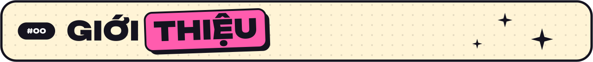
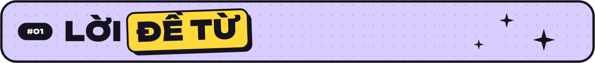
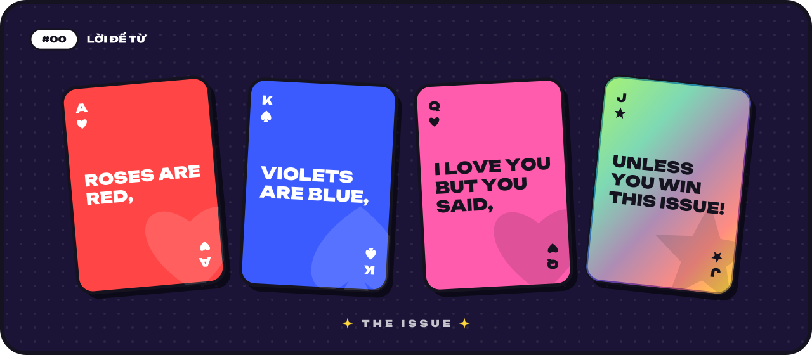
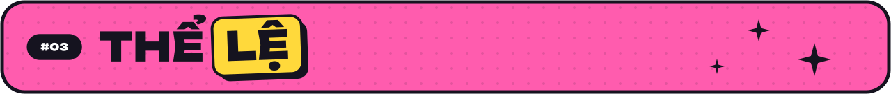
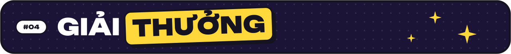
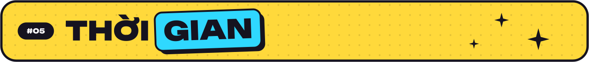

  

  <b>Cuộc thi trắc nghiệm Light Novel có thưởng của TheMeoki × NaviRanobe</b> 
  20 câu hỏi · 60 phút · 3 giải thưởng

 

Kính chào quý độc giả!

**Ranobe Giveaway Booster** là cuộc thi trắc nghiệm light novel có thưởng, được tổ chức để kỉ niệm ngày mở trang của hai trang **TheMeoki** và **NaviRanobe** (đều là ngày 07/03).

Cuộc thi kiểm tra khả năng hiểu và ghi nhớ các yếu tố văn học của light novel, đồng thời rèn luôn kỹ năng tìm kiếm và tra cứu thông tin. Bạn sẽ được thử sức với những câu hỏi về tác phẩm, tác giả, nhà xuất bản, giải thưởng và rất nhiều chuyện bên lề thú vị khác trong thế giới light novel.

Phần thưởng chỉ dành cho người chiến thắng: người có điểm số cao nhất và trả lời trong thời gian ngắn nhất.

 

  

 

Cuộc thi tên là "Booster", nên cả trang web được làm như một **gói thẻ bài**. Bạn cuộn xuống là xé gói, rút thẻ, và mỗi phần nội dung là một lá bài đang chờ được lật.

| Lá bài | Bạn sẽ thấy |
| :-- | :-- |
| **Gói thẻ** | Một gói booster ánh kim. Cuộn để xé nắp và xem những lá đầu tiên bung ra. |
| **Lời đề từ** | Bốn câu thơ trên bốn lá bài, lần lượt lật ngửa theo nhịp cuộn. |
| **Khởi nguyên** | Đôi lời về cuộc thi và lý do nó ra đời. |
| **Ban tổ chức** | Hai "người chơi" đứng sau cuộc thi. |
| **Thời gian** | Tấm vé ghi giờ khai cuộc cùng bộ đếm ngược. |
| **Thể lệ** | Bảy điều luật, mỗi điều một lá. |
| **Giải thưởng** | Ba độ hiếm UR, SR và R cho ba người thắng cuộc. |
| **Tài liệu** | Kono Light Novel ga Sugoi! bốn năm gần nhất để ôn bài. |
| **Mẫu câu hỏi** | Đề thi thử 20 câu của mùa trước, làm ngay trên trang và biết kết quả tức thì. |

 

- Đề thi gồm **20 câu hỏi**, mỗi câu 4 đáp án và chỉ 1 đáp án đúng.
- Thời gian làm bài là **60 phút**, tương đương 3 phút mỗi câu.
- Thí sinh cần cung cấp thông tin đầy đủ và chính xác. Thông tin đăng ký được bảo mật.
- Thí sinh có thể sử dụng bất kỳ phương tiện gian lận nào để giành chiến thắng. Gian lận cũng là một loại thực lực, và chúng tôi không quan tâm.
- Ban tổ chức sẽ liên hệ và trao giải theo thông tin thí sinh đã đăng ký.
- Mọi thắc mắc hay khiếu nại về câu hỏi, mời nhắn tin trực tiếp tới trang Facebook của ban tổ chức.

 

  

- **Giải Nhất:** *Dengeki Wedding 30th Anniversary Artbook*, cuốn artbook khổ A4 kỉ niệm 30 năm Dengeki Bunko với 81 tấm ảnh váy cưới cho 81 tác phẩm.
- **Giải Nhì:** 700.000đ tiền mặt.
- **Giải Ba:** 500.000đ tiền mặt.

Giải Nhì và Giải Ba có thể nhận bằng chuyển khoản, hoặc đổi thành một đơn sách cùng giá trị trên Fahasa, Shopee, Lazada hay Tiki. Ban tổ chức khuyến khích những đơn hàng tiểu thuyết và truyện tranh, vì mục đích sau cùng của cuộc thi là cổ vũ văn hóa đọc nói chung và light novel nói riêng.

 

  <b>20:00 · 02/03/2024</b>

Link bài thi được công bố trước giờ làm bài 5 phút trên hai trang Facebook của ban tổ chức.

Mùa giải 2024 đã khép lại. Hẹn gặp quý độc giả ở mùa sau!

 

Mọi câu hỏi thắc mắc về cuộc thi đều có thể gửi tin nhắn trực tiếp tới hai trang này.

| | Trang | Lời tự giới thiệu |
| :-: | :-- | :-- |
| **Player 1** | [@NaviRanobe](https://facebook.com/NaviRanobe) | Đứa biết nhiều nhất về Light Novel ở Việt Nam |
| **Player 2** | [@TheMeoki](https://facebook.com/TheMeoki) | Đứa biết nhiều thứ hai về Light Novel chuyên đi reply comment xin name |

 

  

  © Ranobe Giveaway Booster 2024 · TheMeoki × NaviRanobe

